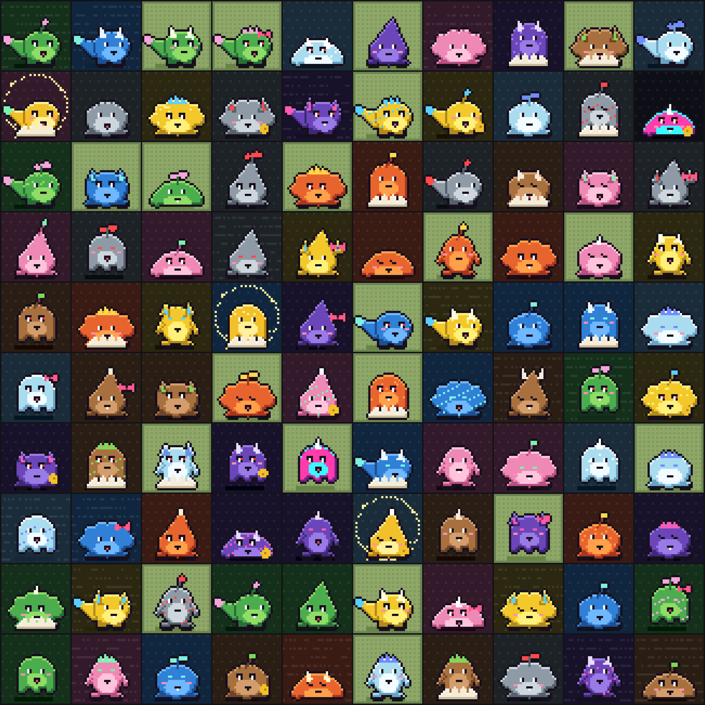

# Bytelings

Pixel monsters, the arcade's own DigiByte ordinals collection. They're a thank-you to everyone who tried DigiDollar
test on the arcade. Each one is drawn by `generate.py` from a seed, so anyone can make the same pictures byte for
byte.



## The first hundred: babies

All 100 are Bits, the baby stage. There are seven forms (Blob, Drop, Puff, Bean, Tadpole, Wisp, Mound) in ten
elements, with heads, eyes, mouths, markings, gear and backgrounds. Three are gold and two are Glitch. Each picture is
32 by 32 pixels and about 350 bytes.

```bash
python3 examples/bytelings/generate.py --sheet sheet.png      # writes examples/bytelings/build/
```

The grown stages are drawn already, for later: Byte, Kilo, Mega and Giga, with Dino, Beast, Dragon, Avian and Imp
bodies (`--stage Kilo`). `stages.png` shows them.

## The launchpad

The pad is paid in DigiDollar test: $1 each, one per account, per DigiByte address and per DigiDollar address. It's
`arcade/ddpad.py`. Its page is `/bytelings`, and the Exchange's Launchpad tab shows it on top.

1. Mint holds a random Byteling for you. Which one stays a surprise until you've paid.
2. Your wallet signs a $1 DigiDollar test send to the pad, built by the Wallet's own DigiDollar send.
3. Once the payment is in a block, the pad sends the Byteling to your DigiByte address.

It's yours from then on, and you can list it on the Exchange for other coins.

The pad holds the pieces in its own key (`ddpad.key` in the arcade's home). It inscribes them to its own address one at
a time, so nobody has to approve a hundred transactions.

Setting it up on an arcade that runs DigiByte and DigiByte test:

```bash
python3 examples/bytelings/generate.py
python -m arcade.ddpad <home> load examples/bytelings/build
python -m arcade.ddpad <home> status          # shows the pad's key; send DGB for the fees to its address
python -m arcade.ddpad <home> set inscribe=true
python -m arcade.ddpad <home> open             # once all 100 are inscribed and in a block
```

Restart the arcade after `load` so its pad thread starts. It ticks every 15 seconds.

## Growing up: every 30 days

Every 30 days after the pad opens, the next stage can be reached: Byte after 30 days, Kilo after 60, Mega after 90,
Giga after 120. The pad page says when the next one opens.

## To do

- **Evolving.** A Bytelings site on the arcade's backbone where an owner signs to burn their babies for a grown one.
  Still to decide: how many babies a Byte costs, how the grown one is chosen (its element and form from the babies
  burned?), and whether it's inscribed by the pad or by the owner.
- **Promo:** the arcade-nodes account's banner, profile picture, a grid and a GIF of the sheet.
- **How-to videos** with demo accounts only: getting DigiDollar test, minting here, the Wallet, and listing and
  swapping on the Exchange.
